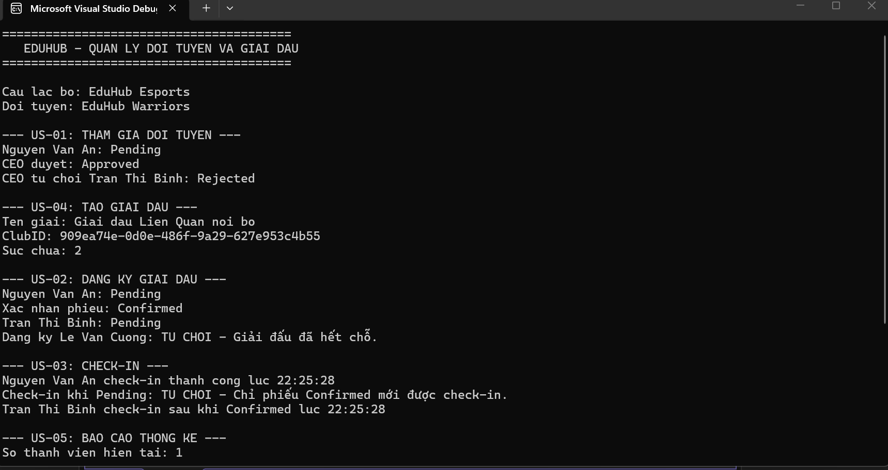
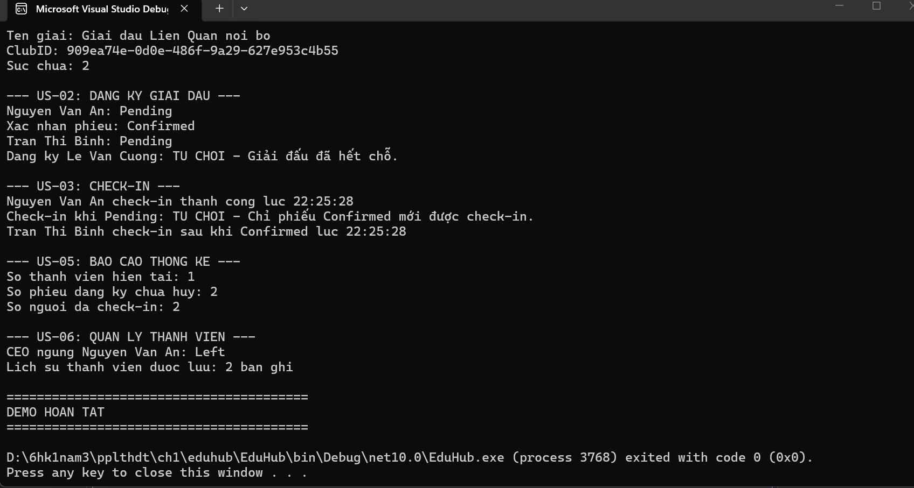

\# EduHub – Quản lý đội tuyển và giải đấu


\*\*MSSV:\*\* 0024418719  

\*\*Công nghệ:\*\* C# Console Application, .NET 10  

\*\*Nhánh làm bài:\*\* `ch01/0024418719`


\## 1. Giới thiệu


EduHub là chương trình console mô phỏng quản lý đội tuyển esports và giải đấu nội bộ. Dự án áp dụng lập trình hướng đối tượng (OOP), đóng gói dữ liệu, kiểm tra dữ liệu đầu vào và quản lý các trạng thái nghiệp vụ.


\## 2. Chức năng chính


\- \*\*US-01:\*\* Gửi, duyệt và từ chối yêu cầu gia nhập đội tuyển.

\- \*\*US-02:\*\* Đăng ký giải đấu và kiểm tra sức chứa.

\- \*\*US-03:\*\* Check-in khi phiếu đăng ký đã được xác nhận.

\- \*\*US-04:\*\* Tạo giải đấu thuộc câu lạc bộ.

\- \*\*US-05:\*\* Thống kê thành viên, phiếu đăng ký và lượt check-in.

\- \*\*US-06:\*\* Quản lý thành viên và lưu lịch sử rời đội.


\## 3. Cấu trúc dự án


\- `Player.cs`: thông tin tuyển thủ.

\- `Club.cs`: thông tin câu lạc bộ.

\- `Team.cs`: thông tin đội tuyển.

\- `TeamMembership.cs`: yêu cầu gia nhập và lịch sử thành viên.

\- `Tournament.cs`: thông tin giải đấu.

\- `Registration.cs`: phiếu đăng ký giải đấu.

\- `CheckIn.cs`: thông tin check-in.

\- `EduHubService.cs`: xử lý nghiệp vụ quản lý.

\- `Program.cs`: chạy demo các luồng nghiệp vụ.

\- `docs/user-stories.md`: User Stories và tiêu chí chấp nhận.

\- `docs/class-diagram.md`: sơ đồ lớp.


\## 4. Cách chạy chương trình


Yêu cầu cài đặt .NET SDK 10.0 trở lên.


Mở terminal tại thư mục chứa `EduHub.csproj` và chạy:


```bash

dotnet run

```


\## 5. Kết quả chạy chương trình


Ảnh minh họa đầu ra:







\## 6. Kiểm thử thủ công


1\. Chạy chương trình bằng `dotnet run`.

2\. Kiểm tra luồng duyệt và từ chối yêu cầu gia nhập đội.

3\. Kiểm tra đăng ký khi giải đấu hết chỗ.

4\. Kiểm tra check-in khi phiếu chưa được xác nhận.

5\. Kiểm tra báo cáo thành viên, đăng ký và check-in.

6\. Kiểm tra lịch sử thành viên sau khi rời đội.

