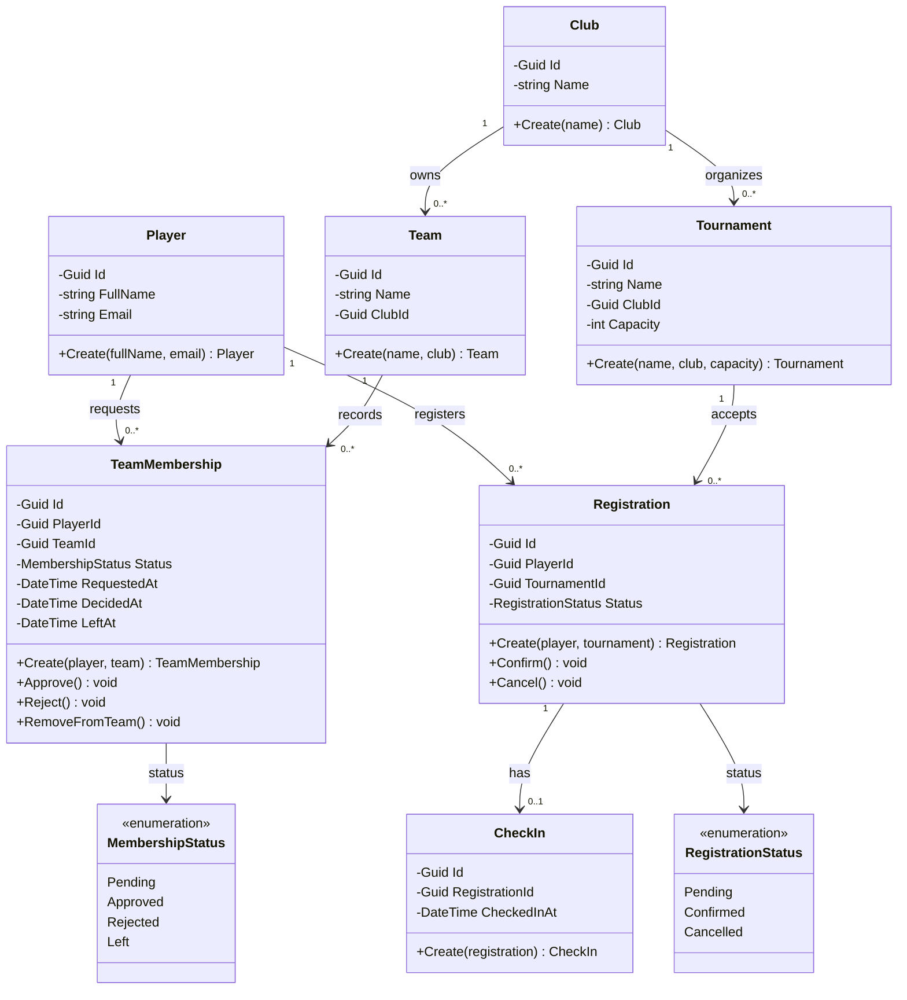

# Class Diagram – EduHub

Sơ đồ mô tả 7 lớp miền nghiệp vụ và các quan hệ giữa chúng.

## Giải thích

- `Club` quản lý các đội tuyển `Team` và giải đấu `Tournament`.
- `TeamMembership` lưu yêu cầu gia nhập, trạng thái duyệt và lịch sử rời đội.
- `Registration` lưu phiếu đăng ký giải đấu; `CheckIn` ghi nhận thời điểm tham dự.
- Các trường `ClubId`, `PlayerId`, `TeamId`, `TournamentId` và `RegistrationId` thể hiện các khóa tham chiếu giữa những lớp liên quan.
- Các thuộc tính được đóng gói bằng `private set`; đối tượng được khởi tạo thông qua phương thức `Create()` để kiểm tra dữ liệu đầu vào.
